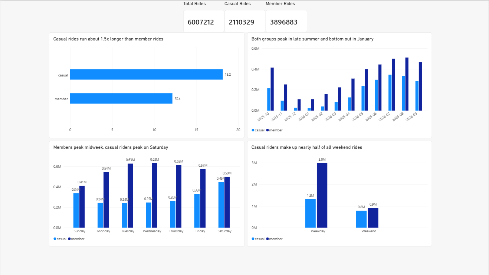
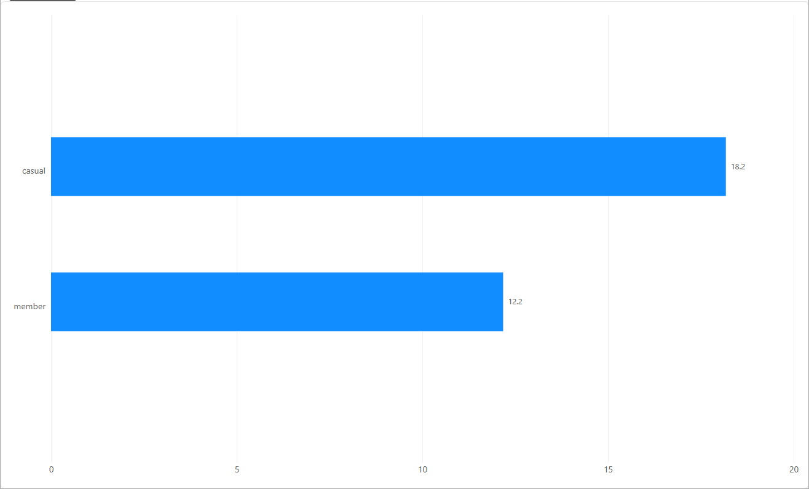
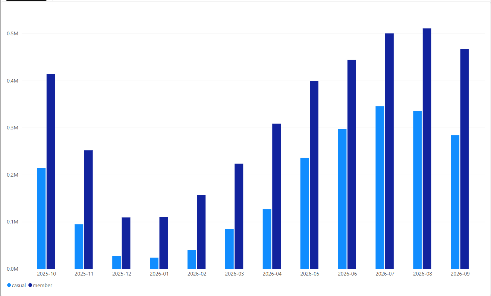
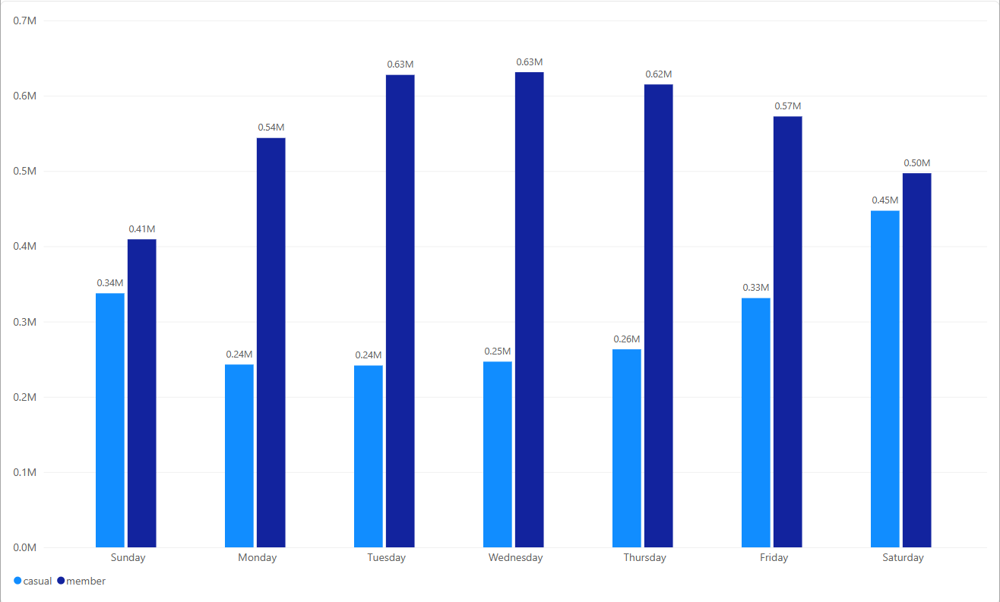
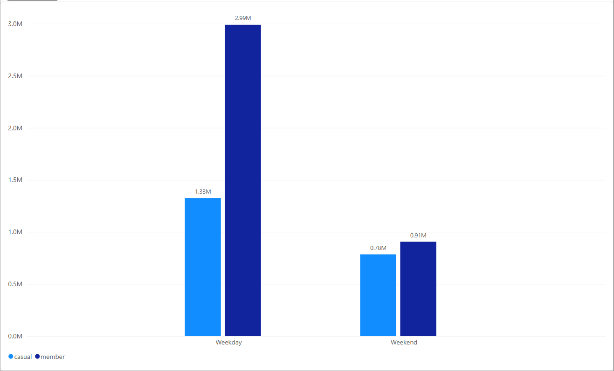
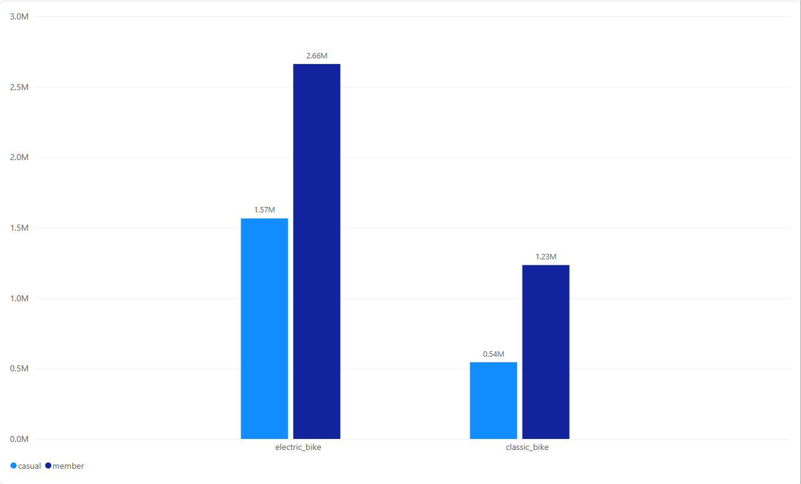
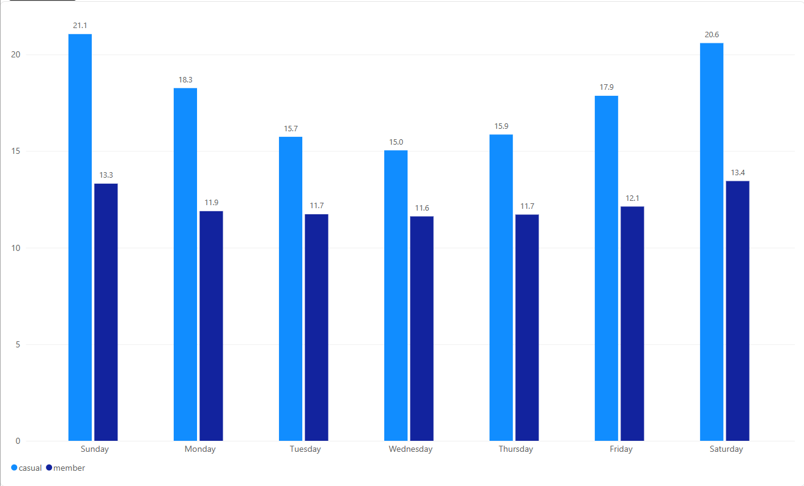
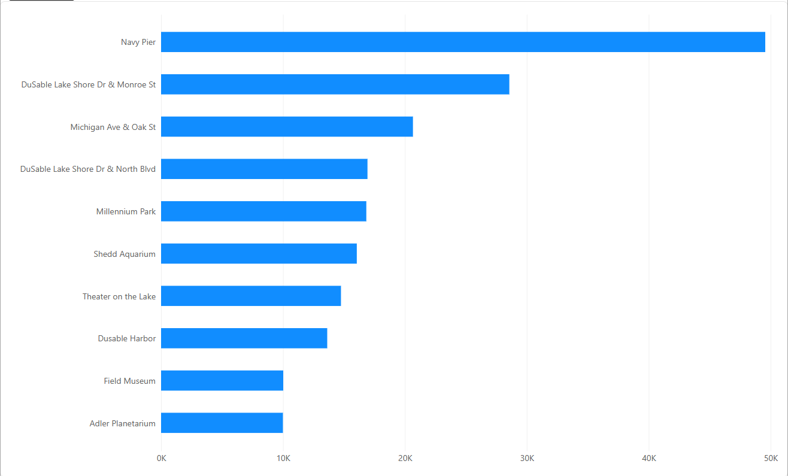

# Cyclistic Capstone: How Members and Casual Riders Use Bikes Differently

Google Data Analytics Professional Certificate, Case Study 1.
Report lives in this README, in the case study roadmap order: Ask, Prepare, Process, Analyze, Share, Act.

## 1. Business task (Ask)

Cyclistic is a bike-share company in Chicago with more than 5,800 bicycles across 600 docking stations. Its riders split into two groups: annual members, who buy a yearly plan, and casual riders, who pay per ride or buy short passes. Cyclistic's director of marketing, Lily Moreno, has concluded that the company's future growth depends on converting casual riders into annual members rather than relying on new customer acquisition, and the executive team will only be convinced by clear evidence of how the two groups behave differently.

The business task for this analysis: use the previous twelve months of trip data to identify how annual members and casual riders use Cyclistic bikes differently, and turn those differences into recommendations for a marketing strategy that converts casual riders into members.

Guiding question assigned: How do annual members and casual riders use Cyclistic bikes differently?

Stakeholders: Lily Moreno (director of marketing, primary), the executive team (approval), and the marketing analytics team.

## 2. Data sources (Prepare)

- Divvy trip data published by Motivate International Inc. under its license agreement, public data with no personally identifiable information.
- Twelve monthly files, 202510 through 202609 (October 2025 through September 2026), the most recent complete twelve months at download time.
- Privacy limits from the case study: payment data stays separate, so rides cannot be tied to purchases, home addresses, or individual riders.
- Full file list, sizes, and download steps: see DATA_NOTES.md.

## 3. Cleaning and manipulation documentation (Process)

Tooling: Python with pandas first, Power BI second. The script clean_cyclistic.py reads the twelve monthly CSVs one file at a time, applies the same rules to each, and writes one cleaned CSV plus a cleaning log. Power BI receives the cleaned CSV only, for measures and visuals, with no fixing inside the dashboard tool.

Why not one merged Excel worksheet: the full year runs to several million rides, and an Excel worksheet caps at 1,048,576 rows. The Python loop handles the full set without trimming the year, and the script itself is the audit trail for this section.

Derived columns, per the case study:
- ride_length: ended_at minus started_at
- day_of_week: 1 = Sunday through 7 = Saturday
- month: pulled from started_at for the seasonality cuts

Cleaning log (run Sunday, November 1, 2026, full per-month detail in cleaning_log.txt):
- Rows in: 6,171,785 across the twelve files. Rows out: 6,007,212. Total dropped: 164,573 (2.67 percent). Every month reconciles exactly.
- [x] Row counts per month, before and after each filter, logged per file
- [x] Duration rules: rides under 1 minute dropped (159,192, 2.58 percent, mostly immediate re-docks), rides over 24 hours dropped (5,324). Longest kept ride in each group sits just under the 1,440 minute cap, confirming the rule bound as intended.
- [x] started_at later than ended_at (negative ride length): 29 rides, all in November 2025, dropped
- [x] Duplicate ride_id: 28 rides, all in May 2026, dropped. Unparseable timestamps: 0 in all twelve files.
- [x] member_casual values check: only member and casual in every file, no unexpected values
- [x] Null station names kept and counted, not dropped: 1,201,906 rides (20.0 percent) have no start station name and 1,245,491 (20.7 percent) have no end station name. These are dockless rides that begin or end off-station. Keeping them preserves real trips. Consequence for the analysis: station-level cuts describe the docked majority only, roughly 80 percent of rides.
- One quirk found during the dashboard build: 71 rides inside the October 2025 file started on September 30, 2025. They are real rides and stay in every total. On the rides-by-month chart only, a visual-level filter hides the one-ride-wide September stub so the twelve intended months read cleanly.
- Three helper columns were added inside Power BI for presentation only (YearMonth, DayName sorted by day_of_week, and PartOfWeek). No values were altered.

## 4. Analysis summary (Analyze)

Cuts run, member against casual: mean and max ride length, ride counts and average ride length by day of week, ride counts by month, weekend against weekday (raw counts and per-day rates), rideable type, and top start stations for casual riders. Every figure below was produced twice, once in Python during cleaning and once from the cleaned data inside Power BI, and the two agree.

Volume:
- Total rides analyzed: 6,007,212. Members: 3,896,883 (64.9 percent). Casual: 2,110,329 (35.1 percent).

Ride length:
- Mean ride length: casual 18.17 minutes, member 12.18 minutes. Casual rides average about 1.5x longer than member rides, and casual rides are longer on every day of the week.
- By day, casual rides run from 15.0 minutes (Wednesday) to 21.1 (Sunday). Member rides stay in a narrow band, 11.6 to 13.4, peaking slightly on the weekend.
- Max kept ride in both groups sits just under the 24-hour cap (about 1,440 minutes), an artifact of the cleaning bound rather than behavior.

When they ride:
- Members peak Tuesday through Thursday (about 0.63M rides each day). That is a commuter signature: weekday, work-shaped, repeatable.
- Casual riders peak on Saturday (about 0.45M) and Sunday (about 0.34M), nearly matching members on Saturday.
- Per-day rates make the split exact. Across the 261 weekdays in the year, members average about 11,400 rides a day against about 8,650 on the 104 weekend days. Casual riders invert it: about 5,100 per weekday, about 7,500 per weekend day. Casual riders are about 31 percent of weekday rides and about 46 percent of weekend rides.

Season:
- Both groups bottom out in December and January and peak in August (846,610 cleaned rides that month). The casual collapse in winter is deeper: casual demand is weather and leisure driven, member demand has a commuting floor under it.

Equipment and place:
- E-bikes are about 70 percent of all rides. Casual rides are about 74 percent electric, member rides about 68 percent. Classic bikes are the minority choice in both groups.
- The top casual start stations are tourist and leisure landmarks: Navy Pier (about 49K rides), DuSable Lake Shore Dr & Monroe St (about 29K), Michigan Ave & Oak St (about 21K), then Millennium Park, the Shedd Aquarium, Theater on the Lake, DuSable Harbor, the Field Museum, and the Adler Planetarium, the rest of the top ten running from about 17K down to about 10K rides each. Counts read from the chart axis; eight of the top ten sit on or near the lakefront. Station cuts cover docked rides only, per the cleaning note in section 3.

The pattern in one line: members ride like commuters and casual riders ride like visitors, short utility trips on weekdays against long leisure trips on weekends, concentrated in summer and along the lakefront.

## 5. Key findings and visualizations (Share)

Dashboard overview (Power BI, two pages: Overview and Details):

**Finding 1: Casual rides run about 1.5x longer than member rides** (18.2 against 12.2 minutes on average).

**Finding 2: Both groups peak in late summer and bottom out in January**, with the casual winter collapse running deeper.

**Finding 3: Members peak midweek, casual riders peak on Saturday**, the commuter and leisure signatures side by side.

**Finding 4: Casual riders make up nearly half of all weekend rides** (about 46 percent), against about 31 percent on weekdays.

**Finding 5: Both groups reach for e-bikes most of the time**, casual riders more so (about 74 percent of their rides).

**Finding 6: Casual rides are longest on Sundays and Saturdays** (21.1 and 20.6 minutes), and longer than member rides on all seven days.

**Finding 7: Casual rides start at lakefront attractions**, led by Navy Pier at about 49K rides.

## 6. Top three recommendations (Act)

Developed from the findings above, and worded to match the behavior the data shows.

1. **Sell membership where casual rides begin.** (Findings 3, 4, 7.) Put the conversion offer at the top casual start stations, Navy Pier, Millennium Park, the Shedd Aquarium, the lakefront corridor, and in the app at the end of a casual weekend ride. The pitch reaches casual riders at the moment and place their leisure riding happens, instead of through channels aimed at commuters.
2. **Run the main campaign in early spring, as casual riders come back.** (Finding 2.) Casual ridership returns ahead of the busy season. A membership bought in early spring covers the rider's whole season, which is the strongest version of the value argument, and it lands before the summer peak rather than during it. Marketing spend aimed at casual riders in winter is spent on an audience that is not riding.
3. **Pitch the pattern casual riders already live: long weekend rides, e-bikes, the lakefront.** (Findings 1, 5, 6.) Frame membership around the leisure riding casual riders demonstrably do, the 20-minute Sunday ride and the e-bike along the lake, rather than as a commuter product. They already behave like weekend members. The offer should say so.

## Files in this repo

- README.md: this report
- clean_cyclistic.py: the cleaning script, with the cleaning log it prints
- The Power BI file (.pbix): the working dashboard. Not stored in this repo: at 368 MB it exceeds GitHub's 100 MB per-file limit. The dashboard's full output is reproduced in section 5.
- DATA_NOTES.md: data source, license, and the exact twelve files
- images/: dashboard screenshots

Raw CSVs and zips stay out of this repo. GitHub file size limits aside, linking to the source is standard practice. DATA_NOTES.md covers reproduction.
